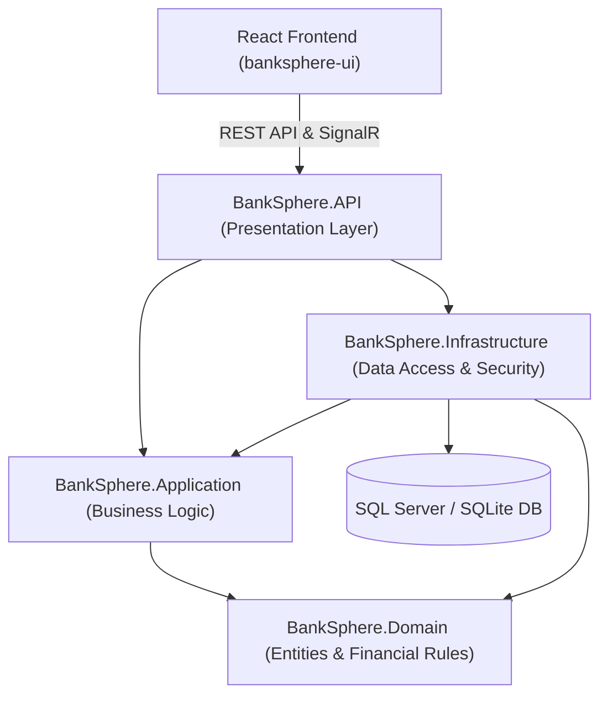
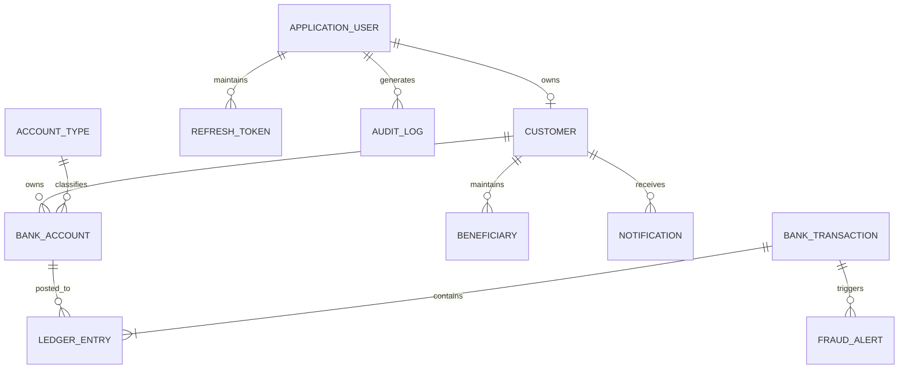

# BankSphere – Smart Banking & Transaction Management System

[](https://github.com/your-username/BankSphere/actions)


-brightgreen.svg)

**BankSphere** is an institutional-grade, full-stack portfolio core banking simulation system built with a **Modular Monolith Clean Architecture**. It features an atomic banking transaction engine with strict double-entry ledger bookkeeping, rule-based fraud detection & anti-money laundering (AML) controls, automated ledger reconciliation, role-based JWT security with refresh token rotation, and a modern responsive React fintech portal with real-time SignalR broadcasts.

---

## 1. Architecture Overview

BankSphere strictly implements Clean Architecture and Domain-Driven Design (DDD) principles:



### Clean Architecture Layers:
1. **BankSphere.Domain**: Pure financial domain model, entities (`BankAccount`, `BankTransaction`, `LedgerEntry`, `FraudAlert`, `Customer`), enums, and domain events. Independent of all external frameworks.
2. **BankSphere.Application**: Core transaction orchestration, double-entry validation rules, fraud detection rules engine, DTOs, interfaces, and FluentValidation validators.
3. **BankSphere.Infrastructure**: Entity Framework Core DbContext, migrations, generic repositories, Unit of Work, cryptographic PBKDF2 password hasher, SHA-256 token hashing, JWT token issuer, and automated reconciliation service.
4. **BankSphere.API**: ASP.NET Core Web API controllers, SignalR `BankingHub`, global RFC 7807 exception handling middleware, Serilog structured logging, and Swagger OpenAPI documentation.
5. **banksphere-ui**: High-performance React 18, TypeScript, Vite, Tailwind CSS, Lucide icons, Recharts analytics, and custom mirror-water refractive glassmorphism design system.

---

## 2. Technology Stack

- **Backend**: C# 13, .NET 9.0 / ASP.NET Core Web API
- **Data Access**: Entity Framework Core 9.0 (Dual-mode: SQL Server for production/Docker and SQLite for zero-config local run)
- **Financial Precision**: `decimal(19,4)` across all monetary balances, transfers, and ledger entries
- **Security**: JWT Access Tokens, Cryptographic PBKDF2 Password Hashing, SHA-256 Refresh Token Rotation & Revocation
- **Real-Time Communication**: ASP.NET Core SignalR
- **Testing**: xUnit, Moq, Microsoft.AspNetCore.Mvc.Testing, In-Memory & Relational Integration testing
- **Frontend**: React 18, TypeScript, Vite, Tailwind CSS, Axios, React Router v7, Recharts
- **DevOps**: Docker, Docker Compose, GitHub Actions CI/CD Pipeline

---

## 3. Database Schema & Entity Relationships

The relational model enforces foreign key constraints, cascaded lifecycles, and unique indexes on financial references:



### Core Entities:
- **ApplicationUser**: Identity account, password hash, role (`Customer`, `Admin`, `Manager`).
- **Customer**: Extended KYC details, customer number (`CUST-XXXXXX`), address, and domicile.
- **BankAccount**: Virtual account number (`10XXXXXXXX`), currency (`USD`), cached balance, and status (`Active`, `Frozen`, `Closed`).
- **AccountType**: Classifies accounts (Checking, High-Yield Savings, Business Premium) with interest rate and daily limits.
- **BankTransaction**: Immutable operation record (`ReferenceNumber`, `IdempotencyKey`, `Amount`, `Fee`, `Type`, `Status`, `FailureReason`).
- **LedgerEntry**: Authoritative bookkeeping record (`Debit` or `Credit`, `Amount`, `BalanceAfter`, `AccountNumber`).
- **FraudAlert**: AML anomaly record (`RuleName`, `Severity`, `RiskScore`, `Status`, `ResolutionNotes`).
- **Beneficiary**: Pre-authorized transfer counterparties.
- **AuditLog**: Immutable compliance trail recording who performed actions, entity changed, and IP address.

---

## 4. Financial Rules & Double-Entry Accounting

### The Golden Invariant:
$$\sum \text{Debits} \equiv \sum \text{Credits}$$

Every financial transaction posted to BankSphere requires at least two balanced ledger entries:
1. **Transfer**:
   - Debit: Source Account (Balance decreases, liability decreases)
   - Credit: Destination Account (Balance increases, liability increases)
2. **Deposit**:
   - Debit: Simulated Central Reserve Asset (`SYS-RESERVE-001`)
   - Credit: Customer Bank Account
3. **Withdrawal**:
   - Debit: Customer Bank Account
   - Credit: Simulated Central Reserve Asset (`SYS-RESERVE-001`)

### Idempotency Protection:
Clients pass an `X-Idempotency-Key` header with transfers. If a duplicate request arrives (e.g. network retry), the system returns the original completed transaction and prevents double debits.

### Automated Reconciliation:
The `ReconciliationService` audits every account by calculating:
$$\text{Authoritative Balance} = \sum \text{Credits} - \sum \text{Debits}$$
and compares it with the cached `BankAccount.Balance`. Any non-zero discrepancy is immediately flagged.

---

## 5. Fraud Detection & AML Rules

The `FraudDetectionEngine` inspects transactions prior to completion:
1. **Critical High Value Anomaly**: Transfers $\ge \$50,000$ trigger critical severity, automatically halting the transaction in `Flagged` status pending compliance review.
2. **High Value Threshold**: Transfers $\ge \$10,000$ trigger high severity review alerts.
3. **Rapid Velocity Anomaly**: 3+ transfers within a 3-minute window generate high-risk alerts.
4. **Balance Drain Rule**: Single transfers consuming $\ge 85\%$ of total account balance trigger high-risk notifications.
5. **Geographic Origin Anomaly**: Flags transactions where client IP origin differs from customer KYC country.

---

## 6. REST API Endpoints

### Authentication
- `POST /api/auth/register` - Register customer & auto-provision welcome checking account
- `POST /api/auth/login` - Authenticate & obtain JWT + Refresh Token
- `POST /api/auth/refresh` - Rotate refresh token & obtain fresh JWT
- `POST /api/auth/logout` - Revoke refresh token

### Customers
- `GET /api/customers/me` - Get current customer dashboard & profile
- `PUT /api/customers/me` - Update contact information

### Bank Accounts
- `POST /api/accounts` - Open new checking / savings / business account
- `GET /api/accounts` - List accounts for authenticated customer
- `GET /api/accounts/{id}` - Account details & balance
- `GET /api/accounts/{id}/balance` - Lightweight balance query
- `PATCH /api/accounts/{id}/status` - Administrative status update (Freeze / Activate / Close)

### Transactions
- `POST /api/transactions/deposit` - Deposit virtual funds
- `POST /api/transactions/withdraw` - Withdraw cash
- `POST /api/transactions/transfer` - Atomic transfer with idempotency & double-entry
- `GET /api/transactions` - Filtered & paginated transaction history
- `GET /api/transactions/{id}` - Transaction details & posted ledger entries
- `GET /api/transactions/statement` - Downloadable CSV statement

### Beneficiaries
- `POST /api/beneficiaries` - Register authorized counterparty
- `GET /api/beneficiaries` - List saved beneficiaries
- `DELETE /api/beneficiaries/{id}` - Delete beneficiary

### Administration & Compliance
- `GET /api/admin/dashboard` - System reserves, daily volumes, audit trail
- `GET /api/admin/customers` - Customer directory with KYC statuses
- `GET /api/admin/accounts` - Complete system account ledger
- `GET /api/admin/fraud-alerts` - Active AML & fraud alert queue
- `PATCH /api/admin/fraud-alerts/{id}/review` - Clear, escalate, or confirm fraud
- `GET /api/admin/reconciliation` - Run automated double-entry ledger reconciliation

### Analytics
- `GET /api/analytics/overview` - Aggregate financial KPIs
- `GET /api/analytics/monthly-transactions` - Inflows vs outflows
- `GET /api/analytics/spending` - Expense distribution by category

---

## 7. Seeded Demonstration Accounts

| Role | Email | Password | Initial State |
| :--- | :--- | :--- | :--- |
| **System Admin** | `admin@banksphere.com` | `AdminPass123!` | Complete administrative oversight, fraud resolution, reconciliation |
| **Operations Manager** | `manager@banksphere.com` | `ManagerPass123!` | Operational review & AML monitoring |
| **Customer 1 (John)** | `john.doe@banksphere.com` | `CustomerPass123!` | Checking ($25,000.00) & Savings ($50,000.00) with transaction history |
| **Customer 2 (Jane)** | `jane.smith@banksphere.com` | `CustomerPass123!` | Checking ($15,000.00) |

*(Note: New registrations automatically receive a Standard Checking account with a \$1,000 demonstration bonus).*

---

## 8. Local Setup & Execution

### Prerequisites:
- [.NET 9.0 SDK](https://dotnet.microsoft.com/download/dotnet/9.0)
- [Node.js (v20+)](https://nodejs.org/) & npm

### Step 1: Run Backend Web API
```powershell
cd backend\BankSphere.API
dotnet run --urls "http://localhost:5000"
```
The database will automatically initialize and seed demonstration accounts on startup.
- **Swagger Documentation**: `http://localhost:5000/swagger`
- **SignalR Hub**: `http://localhost:5000/hubs/banking`

### Step 2: Run React Frontend
```powershell
cd frontend\banksphere-ui
npm install
npm run dev
```
- Open your browser at `http://localhost:5173`

---

## 9. Docker Deployment

BankSphere includes full multi-container Docker Compose configuration:

```bash
docker compose up --build
```

### Services:
- **`banksphere-db`**: Microsoft SQL Server 2022 on port `1433`
- **`banksphere-api`**: ASP.NET Core 9 Web API on port `5000`
- **`banksphere-ui`**: Nginx-served React Single Page App on port `3000`

---

## 10. Automated Testing

Run the automated test suite from the repository root:

```powershell
dotnet test backend/BankSphere.sln
```

### Test Coverage:
- **Ledger Invariant Verification**: Asserts $\sum \text{Debits} == \sum \text{Credits}$ across all transactions.
- **Atomic Rollback**: Confirms balances are completely untouched on insufficient funds or errors.
- **Idempotency**: Asserts duplicate requests with identical `X-Idempotency-Key` never double-charge.
- **Role Authorization**: Verifies customers are forbidden from admin endpoints and other customer accounts.
- **AML & Fraud Rules**: High-value anomalies, rapid velocity, and balance drain trigger review alerts.

---

## 11. Security & Compliance Highlights

- **Passwords**: Hashed with PBKDF2 using 100,000 SHA-256 iterations and unique 128-bit cryptographic salts. Plaintext passwords never stored.
- **Refresh Tokens**: Hashed with SHA-256 before storage in database to prevent token theft in the event of database exfiltration.
- **Anti-Overdraft**: Balances validated in transactional boundary. Negative balances are strictly rejected.
- **Reconciliation Invariant**: Account cached balances reconciled directly against posted ledger lines.
